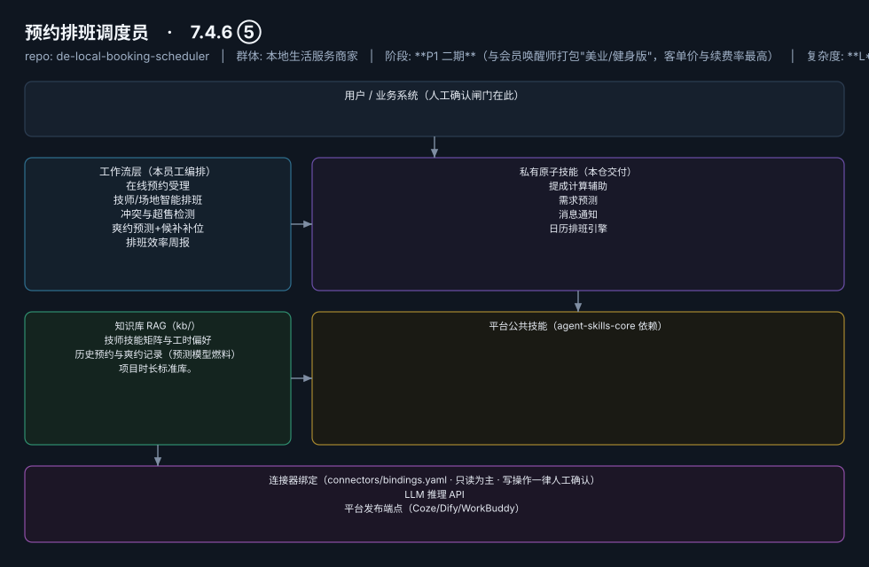

# 预约排班调度员

> 漏单错单归零、低谷填平的排班大脑
>
> **7.4.6 ⑤**　·　本地生活服务商家　·　阶段 **P1 二期**（与会员唤醒师打包"美业/健身版"，客单价与续费率最高）　·　
> 复杂度 **L**（排班引擎需定制开发）　·　100–300 元/月（美业 SaaS 主流价位，据 R4 调研）；**代配置服务加成：800–2000 元/次**（预约入口搭建+技师与项目库灌入+小程序对接——本群体内配置难度最高，加成空间最大）　·　定义卡 7.4.6 ⑤



## 效果（真实执行）


*上图为**真实效果对比**，不是示意图：左栏是输入材料与要求，右栏是该次执行的产出原文，
两栏取自同一次真实执行记录。*

- 完整台账：[`reports/real-run/wf-local-booking-conflict-check.md`](reports/real-run/wf-local-booking-conflict-check.md)
- 录屏与终端回放：[`workflows/wf-local-booking-conflict-check/docs/images/`](workflows/wf-local-booking-conflict-check/docs/images/)（`08-demo-run.gif` / `08-demo-run.mp4` / `04-terminal-run.png`）
- 使用示例：[`workflows/wf-local-booking-conflict-check/docs/使用示例.md`](workflows/wf-local-booking-conflict-check/docs/使用示例.md)
> 实测判定：**通过**　·　可用度 4/5　·　编造数字 0 处　·　红线命中 0 次 / 拦截 0 次


**一句话**：美业/健身/家政/教培等预约制门店（约千万级，餐饮不适用，据 R4 调研）

---

## 这个数字员工解决什么问题

云端 7×24（预约入口须全天在线）；排班引擎为唯一 L 级组件，建议以"半自动建议+人工确认"形态首发。

| 项 | 内容 |
|---|---|
| 服务对象 | 美业/健身/家政/教培等预约制门店（约千万级，餐饮不适用，据 R4 调研） |
| 可量化目标 | 漏单错单率 → 0；爽约率下降 ≥30%；低谷时段上座率提升可追踪 |
| 投入产出 | 爽约率降 30%+漏单归零，月挽回数千元直接损失，ROI 最硬 |
| 需求依据 | 无 |
| 分发渠道 | GitHub（必备）、**淘宝/闲鱼**（美业 SaaS 代购与代配置服务聚集地）、腾讯 WorkBuddy Skill 市场、千问办公 |

## 30 秒上手

```bash
git clone <本仓库地址> && cd de-local-booking-scheduler
pip install pyyaml
python3 tests/run.py            # 先跑一遍自检，确认环境与契约都对得上
```

试用（把 `<输入>` 换成本人真实材料）：

```text
请以「预约排班调度员」的身份，帮我跑「在线预约受理」。
材料如下：<输入>
要求：只使用材料里出现过的数字，缺的写 <待填>；对外文案停在待确认状态。
```

详细接入见 [`docs/01-安装与接入.md`](docs/01-安装与接入.md)。

## 仓库结构

```text
de-local-booking-scheduler/
├── employee.yaml          # 机器契约（能力清单 + 依赖锁）
├── dependencies.yaml      # 对 core 的外部依赖（含版本）
├── persona/               # 运行提示词 / 边界 / KPI
├── skills/                # 私有原子技能（4 个）
├── spec-bindings/         # 有意不公共化能力的本地绑定声明（0 个）
├── workflows/             # 本员工工作流（5 条）
├── kb/                    # 知识库 RAG 契约
├── connectors/            # 连接器绑定（只读为主，写操作人工确认）
├── docs/                  # 六类发布文档
└── tests/                 # 自动化多场景测试
```

## 私有原子技能（4）

| 技能 | slug | 复杂度 | 阶段 | 成熟度 |
|---|---|---|---|---|
| `提成计算辅助` | `commission-calculator` | S | P2 | 契约完备 |
| `需求预测` | `demand-forecast` | M | P1 | 契约完备 |
| `消息通知` | `notification-dispatcher` | M | P1 | 契约完备 |
| `日历排班引擎` | `shift-calendar-engine` | L | P1 | 契约完备 |

## 平台公共技能依赖（0）

（无）

> 这些技能来自 `agent-skills-core@1.0.0`，本仓库**只引用不复制**。

## Spec 绑定层（0）

（无）

> 这一族能力**有意不公共化**（与外部平台接口强绑定）。本仓不存正文，
> 只留本地绑定声明与连接器配置。

## 工作流（5）

| 工作流 | slug | 触发 | 阶段 | 调用技能数 |
|---|---|---|---|---|
| `在线预约受理` | `wf-local-booking-collect` | 事件（客户微信/小程序发起） | P1 | 1 |
| `技师/场地智能排班` | `wf-local-booking-schedule` | 定时（每日 6:30） | P1 | 1 |
| `冲突与超售检测` | `wf-local-booking-conflict-check` | 事件（新预约写入） | P1 | 1 |
| `爽约预测+候补补位` | `wf-local-booking-noshow-remind` | 定时（每日两次扫描） | P1 | 2 |
| `排班效率周报` | `wf-local-booking-efficiency-weekly` | 定时（每周一） | P2 | 2 |

## 知识库与连接器

- 知识库语料：['技师技能矩阵与工时偏好', '历史预约与爽约记录（预测模型燃料）', '项目时长标准库。']
- 连接器：LLM 推理 API、平台发布端点（Coze/Dify/WorkBuddy）

## 质量与验收

| 项 | 值 |
|---|---|
| 技能文件数 | 185 |
| 多场景用例数 | 246 |
| 用例通过 | 246 |
| 验收结论 | ✅ 通过 |

完整报告：[`docs/05-验收与测试.md`](docs/05-验收与测试.md)

## 许可

专有许可，详见 [`LICENSE`](LICENSE)。
