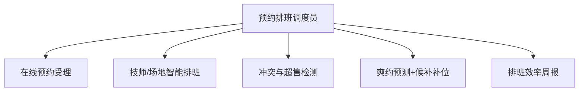

# 数字员工定义卡：预约排班调度员

> 遵循 [小班底数字员工资产规范](https://github.com/xiaobandi/digital-employee-spec) v1.0（12 主字段 + 2 扩展组）
> 本卡为人读快照，机器契约以 [`employee.yaml`](employee.yaml) 为准。

## A. 身份定义

| 字段 | 内容 |
|------|------|
| 名称 | **预约排班调度员** |
| 别名 / 旧名存档 | None |
| 一句话定位 | 漏单错单归零、低谷填平的排班大脑 |
| 目标用户 | 美业/健身/家政/教培等预约制门店（约千万级，餐饮不适用，据 R4 调研） |
| 所属客群 | 本地生活服务商家 |
| 仓库 | `de-local-booking-scheduler` |
| 定义卡编号 | 7.4.6 ⑤ |
| 版本 | 1.0.0 |
| 阶段 | **P1 二期**（与会员唤醒师打包"美业/健身版"，客单价与续费率最高） |
| 复杂度 | **L**（排班引擎需定制开发） |

## B. 角色边界（做 / 不做）

| 做 | 不做 |
|----|------|
| **做**：预约受理、智能排班、冲突检测、爽约预测、到店提醒；**不做**：不接管收银、不做技师绩效仲裁 | — |

## C. 目标与 KPI

漏单错单率 → 0；爽约率下降 ≥30%；低谷时段上座率提升可追踪

## D. 工程与商业属性

| 字段 | 内容 |
|------|------|
| 评分 | 20 |
| 定价 | 100–300 元/月（美业 SaaS 主流价位，据 R4 调研）；**代配置服务加成：800–2000 元/次**（预约入口搭建+技师与项目库灌入+小程序对接——本群体内配置难度最高，加成空间最大） |
| 投入产出（ROI） | 爽约率降 30%+漏单归零，月挽回数千元直接损失，ROI 最硬 |
| 分发渠道 | GitHub（必备）、**淘宝/闲鱼**（美业 SaaS 代购与代配置服务聚集地）、腾讯 WorkBuddy Skill 市场、千问办公 |

## E. System Prompt

```text
"优先级：客户体验 > 技师负荷均衡 > 场地利用率；排班冲突必须显式报告，不许静默覆盖"
```

> 完整运行提示词见 [`persona/system-prompt.md`](persona/system-prompt.md)。

## F. 工作流清单（5 条）



| # | 工作流 | 名称 | 触发方式 | 阶段 | 调用技能 |
|---|--------|------|---------|------|---------|
| 1 | `wf-local-booking-collect` | 在线预约受理 | 事件（客户微信/小程序发起） | P1 | shift-calendar-engine |
| 2 | `wf-local-booking-schedule` | 技师/场地智能排班 | 定时（每日 6:30） | P1 | shift-calendar-engine |
| 3 | `wf-local-booking-conflict-check` | 冲突与超售检测 | 事件（新预约写入） | P1 | shift-calendar-engine |
| 4 | `wf-local-booking-noshow-remind` | 爽约预测+候补补位 | 定时（每日两次扫描） | P1 | demand-forecast、notification-dispatcher |
| 5 | `wf-local-booking-efficiency-weekly` | 排班效率周报 | 定时（每周一） | P2 | demand-forecast、notification-dispatcher |

**步骤链路**：`wf-local-booking-collect`：意图识别 → 项目/技师/时间匹配 → 确认；`wf-local-booking-schedule`：当日预约 → 排班表 → 负荷均衡调整建议；`wf-local-booking-conflict-check`：实时冲突扫描 → 老板确认改派方案；`wf-local-booking-noshow-remind`：历史爽约特征打分 → 高风险预约提前确认 → 爽约后候补名单自动通知；`wf-local-booking-efficiency-weekly`：上座率热力图 → 低谷时段促销建议

## G. 技能清单（4 个私有）

| 技能 | 名称 | 成熟度 | 版本 |
|------|------|--------|------|
| `commission-calculator` | 提成计算辅助 | contract-complete | 1.0.0 |
| `demand-forecast` | 需求预测 | contract-complete | 1.0.0 |
| `notification-dispatcher` | 消息通知 | contract-complete | 1.0.0 |
| `shift-calendar-engine` | 日历排班引擎 | contract-complete | 1.0.0 |

## H. 知识库与连接器

| 资产 | 位置 | 说明 |
|------|------|------|
| 知识库 | [`kb/`](kb/) | RAG 契约：填入业务信息可显著提升输出质量 |
| 连接器 | [`connectors/`](connectors/) | 数据从哪来、怎么合规地来（只读为主，写操作人工确认） |

## I. 需求溯源

| 字段 | 内容 |
|------|------|
| 需求编号 | 无 |
| 需求支持度 | 表外 |
| 证据置信度 |  |

## J. 可信三字段

| 字段 | 值 |
|------|-----|
| 需求支持度 | 表外 |
| 证据置信度 |  |
| 使用边界 | 见 B 段（做 / 不做） |

---

*本卡由 `tools/upgrade_facade.py` 依定义卡规范自动生成，请勿手工编辑；改 `employee.yaml` 后重跑即可刷新。*
