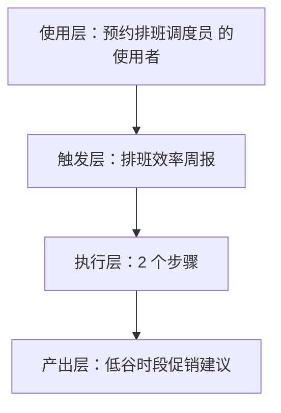
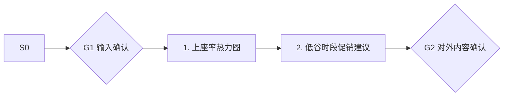

# 排班效率周报 · 架构与流程图

## 本工作流的四层结构

| 层 | 内容 |
|---|---|
| 使用层 | 美业/健身/家政/教培等预约制门店（约千万级，餐饮不适用，据 R4 调研）；员工定位：漏单错单归零、低谷填平的排班大脑 |
| 触发层 | 关键词 / 显式点名「排班效率周报」；触发方式：定时（每周一） |
| 执行层 | 上座率热力图 → 低谷时段促销建议 |
| 产出层 | 低谷时段促销建议 |

## 执行流程

## 步骤职责表

| # | 步骤 | 承担者 | 为什么 |
|---|---|---|---|
| 1 | 上座率热力图 | 模型 | 需要读懂语境，不可用固定规则替代 |
| 2 | 低谷时段促销建议 | 模型 | 需要读懂语境，不可用固定规则替代 |

⚠️ 尚未补齐：图中的步骤来自注册表口径，未逐条实跑校验；实跑后请同步修订本页（`发布标准.md` 第六项：通读一遍，不得出现重复填充句）。
